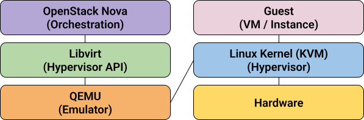
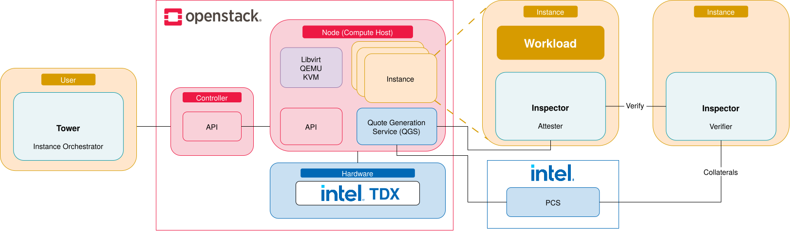
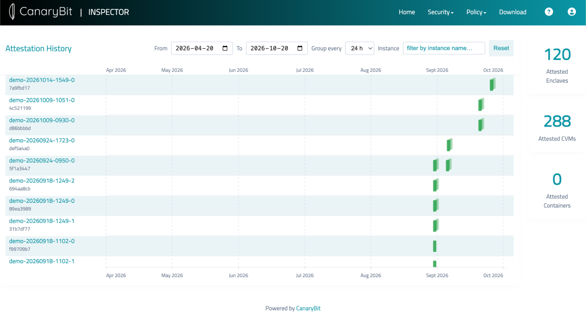

# OpenStack deployment architecture with Intel TDX and CanaryBit solutions
## Confidential Computing
Data is usually protected at rest, on disk, and in transit, over the network. Confidential computing closes the remaining gap: protecting data in use. It does this with a hardware-based Trusted Execution Environment (TEE) built into the processor, which keeps a workload’s memory and execution state isolated from everything else on the system. That includes the host operating system, the hypervisor, and the administrators who operate them.

The result is a different trust model. Rather than trusting the infrastructure operator to behave, you trust the silicon and verify it. Through a process called remote attestation, a workload can cryptographically prove that it is running on genuine TEE hardware, in an expected configuration.

## About OpenStack (Nova)
OpenStack is an open-source cloud platform that turns pools of compute, storage, and networking hardware into a self-service cloud, managed through APIs and a dashboard. It is built from a family of cooperating services, each responsible for one slice of the infrastructure, which together let an organization run its own cloud on its own machines.

At the center of that family is Nova, the compute service. Nova creates and orchestrates instances, better known as Virtual Machines (VMs), across a wide range of platforms. In this architecture, the target environment is Libvirt/QEMU running on a bare-metal Linux machine, with the Kernel Virtual Machine (KVM) doing the heavy lifting as the hypervisor.

## The OpenStack Virtualisation Stack
Nova sits at the very top of the stack, handling orchestration and instance management. It hands the hands-on work to Libvirt, which creates and manages resources. Libvirt in turn drives QEMU, which emulates the interfaces a guest expects, and QEMU relies on the Linux kernel’s KVM as the hypervisor underneath. OpenStack weaves these layers into a fully managed cloud service, one that can stretch across far more machines than a typical standalone deployment.

On a single OpenStack node, the stack loosely looks like this:

## Confidential Computing in OpenStack
In OpenStack, the security boundary is the virtual machine. Nova launches Trusted Domains (TDs), instances backed by Intel Trust Domain Extensions (Intel TDX) memory encryption, so a guest’s memory stays encrypted and inaccessible to the hypervisor and the host it runs on. Even an operator with full control of the compute node cannot inspect the contents of a running instance.

Nova’s job ends at launching and managing these instances; it does not establish trust on its own. That is where remote attestation comes in to verify that a workload is running inside a genuine TD.
About CanaryBit
CanaryBit provides platform agnostic tooling for provisioning and verifying confidential environments based on Trusted Execution Environments (TEEs). Among the supported technologies and platforms is Intel TDX and OpenStack. This reference architecture leverages Tower to provision Intel TDX backed instances on OpenStack and Inspector to attest and verify the integrity and confidentiality of those environments.

# Overview
The diagram describes how OpenStack, Intel TDX and CanaryBit solutions integrate with each other to create a fully confidential, integrity reinforced openstack instance. 

## Deploying a Trust Domain Via CanaryBit Tower
CanaryBit Tower builds on Terraform to provide Infrastructure as Code (IaC) capabilities for the creation of confidential environments. In this case it uses OpenStack as the target environment and communicates with the Controller node over OpenStack API to create an instance backed by Intel TDX. It does so by utilizing a flavor and image which has been configured to enable the necessary memory encryption parameters necessary for Intel TDX. 

Once Tower performs the necessary API calls to OpenStack it is then left to OpenStack to create and manage the actual instance. Tower can then be used to perform additional life cycle operations, such as destroying the instance.

In addition to this, Tower also configures the cloud-init user-data for the instance with the necessary guest side configurations to prepare it for remote attestation. This includes injecting the CanaryBit Inspector client that will later be used to communicate with Inspector to perform attestations.

## Via Openstack CLI

TBA

## OpenStack
The diagram resembles the OpenStack deployment as one Controller node and one Compute node. In reality the deployment can look very different but the core functionality stays the same. The Controller is the brain on the entire deployment and outside communication goes via it. Internal APIs are then used to communicate with the Compute nodes that actually enable the creation of compute resources. 

### Compute Node

The compute node in of itself consists of a handful of components. With every Compute node deployment of OpenStack comes the main driver Libvirt, which in turn comes with QEMU which both depend on the Kernel Virtual Machine (KVM) from the Linux Kernel. This is the core virtualization stack that is leveraged and what actually creates the instance. The life cycle management of these instances is then managed by OpenStack via the API, and in turn Tower.

In addition to the regular deployment of an OpenStack Compute node there is also the requirement of the Quote Generation Service (QGS) from Intel. This is a service that runs on the host which communicates with the hardware and the Intel Provisioning Certification Service (PCS) to facilitate Quote generation, which is then used in remote attestation.

The instances that are backed by Intel TDX exist on the Compute node and is managed by OpenStack API. OpenStack has no insight into the machines, since the memory is encrypted from the start and thus hidden from the hypervisor (KVM). A correctly created confidential instance has full memory encryption and integrity, but whether it is an authentic Trust Domain (TD) needs to be verified in order to trust that the confidentiality and integrity is in fact active.

## Attestation with CanaryBit Inspector
As mentioned before, Tower sets up the required parts for the remote attestation to be possible inside the instance (guest). Remote attestation typically follows two steps: Attest + Verify. CanaryBits Inspector is what facilitates both of these steps. 

The first part is when evidence is gathered from the hardware. This is where the hardware provides a cryptographically valid report of the state of the hardware including hardware keys that prove the origin and authenticity of the environment; this is what builds the hardware root of trust. For Intel TDX this additionally goes via the Quote Generation Service (QGS) which communicates with the hardware to create the evidence and additionally adds the necessary parts needed for it to be remotely verified, the quote. This is done by communicating from the instance over an unix socket. 

Inspector client is the Attester in this model and it first gathers the hardware evidence and sends it over to the QGS to get a quote. This quote is then sent over to Inspector to be verified remotely. The key insight here is that Inspector can be anywhere that the instance can reach. It can be inside the OpenStack deployment, locally on the users machine, in some third party cloud or really anywhere. Ideally, however, the Inspector instance used for the verification would be owned or at least trusted by the same party that deploys the instance, thus separating it from the infrastructure provider.

Once Inspector gets the quote generated by Attester it verifies it by checking: <TODO: INSERT checks here>. It can then with cryptographic proof confirm that the environment is in fact an authentic Intel TDX deployment and thus the confidentiality and integrity guarantees hold. These results are then stored in a database as the full attestation report. 

Remote attestation always starts from the inside the instance and can be done whenever it is deemed necessary. Inspector keeps track of all attestations and decisions can be made from the outside of the instance as to whether it is deemed reliable and secure still. Via CanaryBit Inspector Dashboard the end user can keep track of all deployed instances and audit the attestation status over time.

### Usage
Once attested, the instance is confirmed to use memory encryption backed by Intel TDX, and evidence of it is available through Inspector. Sensitive data can then be processed, and proprietary algorithms or AI models can be used inside the instance without concerns of the infrastructure provider getting access to it. Ensurances backed by Intel TDX and verified by CanaryBit. In this model OpenStack is simply the compute provider and the only trust that is required is between the hardware provider (Intel) and the end user.

Inspector further builds on the hardware root of trust by collecting additional metadata from the instance. It can be used to determine if the correct configuration was applied, what hypervisor it is running on, what operating system is running, what IP it has and so on. In turn this enables fine-grained auditing of the deployments which can be used to enforce compliance and service agreements. It also further improves the integrity and hardening of the environment by enabling vulnerability scanning, rooted in the same trust given by Intel TDX. All in all it gives the assurance that an instance deployed is the instance desired and that it is in a state that cannot be tampered with.
