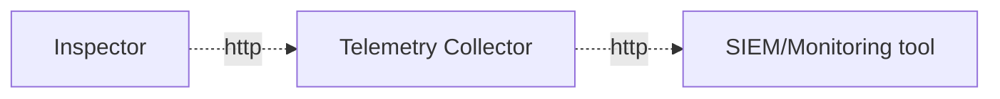

# SIEM integration

Get a snapshot of your IT infrastructure in your SIEM or monitoring tool. 

--- 

The Inspector attestation reports connector allows  end-users to easily collect attestation events from CanaryBit Inspector and forward them to a telemetry data collector (e.g. FluentBit). 
The data collector system can then be connected to a monitoring tool (e.g. Grafana, Splunk, etc...) for log aggregation and alerting.



## Requirements

 - A CanaryBit Inspector [license](/products/inspector/#licences)

## Configuration

The following variables are required by the connector:

- `CB_USERNAME` and `CB_PASSWORD` for CanaryBit authentication;
- `TELEMETRY_DATA_COLLECTOR_URI` to transfer attestation events to a SIEM/monitoring system.

An end-user can deploy the connector as either a `systemd` service or as Docker a container.

### Systemd

1. Create both a `.service` and `.timer` file under the `systemd` directory: 
    
    ``` title="/etc/systemd/system/connector.service"
    [Unit]
    Description=CanaryBit Inspector attestation reports connector
    
    [Service]
    Type=oneshot
    ExecStart=/bin/bash -c 'source my-env.rc && /usr/bin/python3 <PATH>/connector.py
    ```

    ``` title="/etc/systemd/system/connector.timer"
    [Unit]
    Description=Run the connector daily
    
    [Timer]         
    OnCalendar=daily
    Persistent=true
    
    [Install]
    WantedBy=timers.target
    ```

2. Launch the script with:
    ```
    sudo systemctl daemon-reload
    sudo systemctl enable --now connector.timer
    ```

### Container

``` 
docker run --rm \
  --network <CUSTOM_NETWORK> \
  -e CB_USERNAME \
  -e CB_PASSWORD \
  -e TELEMETRY_DATA_COLLECTOR_URI \
  -v "./last_polling:/app/last_polling" \
  ghcr.io/canarybit/inspector-attestations-connector:latest
```

## Example

In this example we use [FluentBit](https://fluentbit.io) and [Grafana](https://grafana.com) as telemetry data collector and monitoring tool, respectively.

   1. Create and source a `my-env.rc` file with the following environment variables:

      ``` 
      export CB_USERNAME=***
      export CB_PASSWORD=***
      
      export TELEMETRY_DATA_COLLECTOR_URI=http://fluentbit:9880/attestation.events
      
      export LOKI_HOST=logs-prod-XYZ.grafana.net
      export LOKI_USER=***
      export LOKI_PASSWORD=***
      ```

   2. Configure [Loki](https://docs.fluentbit.io/manual/data-pipeline/outputs/loki) as FluentBit output plugin:

      ```
      [SERVICE]
       Flush         1
       Log_Level     info

      [INPUT]
          # DO NOT REMOVE !!! Receive the results from the connector via http          
          Name         http
          Listen       0.0.0.0
          Port         9880

      [FILTER]
          # DO NOT REMOVE !!! Parse the input and convert it to a multi-line format
          Name    lua
          Match   *
          script  /fluent-bit/etc/parse-attestations.lua
          call    split_json
      
      [OUTPUT]
          Name          loki
          Match         *
          Host          ${LOKI_HOST}
          Port          443
          tls           On
          tls.verify    On
          http_user     ${LOKI_USER}
          http_passwd   ${LOKI_PASSWORD}
          Labels        job=my_attestations
          line_format   json
      ```

    !!! note
           Label is used to identify the events and query the results in Grafana. In this example, we used `job=my_attestations`        

   2. Launch FluentBit:

      ```
      docker run -d \
        --network my-network \
        --name fluentbit \
        -e LOKI_HOST \
        -e LOKI_USER \
        -e LOKI_PASSWORD \
        -v "$(pwd)/fluent-bit.conf:/fluent-bit/etc/fluent-bit.conf:ro" \
        -v "$(pwd)/filter-attestations.lua:/fluent-bit/etc/filter-attestations.lua:ro" \
        --restart unless-stopped \
        fluent/fluent-bit:latest \
        /fluent-bit/bin/fluent-bit -c /fluent-bit/etc/fluent-bit.conf
      ```

   3. Launch the connector:

      ``` 
      docker run --rm \
        --network my-network \
        -e CB_USERNAME \
        -e CB_PASSWORD \
        -e TELEMETRY_DATA_COLLECTOR_URI \
        -v "./last_polling:/app/last_polling" \
        ghcr.io/canarybit/inspector-attestations-connector:latest
      ```
   
    !!! warning 
        Make sure that both containers are on the same network, in this example we used `my-network`.
     